# Solar Schlage Encode
This is a solar power mod for Schlage Encode smart locks.

## Tools
* 3D printer
* Screwdriver
* Wire strippers
* Soldering iron
* [Spot welder](https://www.amazon.com/dp/B0DBCZGL4P) (optional)

## Parts

* [500mAh LiPo battery](https://www.adafruit.com/product/1578)
* [Power wires with inline connector](https://www.adafruit.com/product/4720)
* [Solar charger board](https://www.adafruit.com/product/6106)
* [Solar panel](https://www.adafruit.com/product/5366)
* [7mm nickel strip](https://www.amazon.com/dp/B0DLGTQ156)
* [Outdoor rated hook and loop tape](https://www.amazon.com/dp/B09BNPHCZX)

## Build

### Battery Pack

3D print the replacement battery pack.  
Cut two 2cm (~3/4") lengths of nickel strip.  
Bend the nickel strips into 3 equal sized sections and insert them into battery pack.  
Fold the end of the nickel strips over each other and spot weld or solder them together.  

> [!NOTE]
> Spot welding is recommended over soldering.

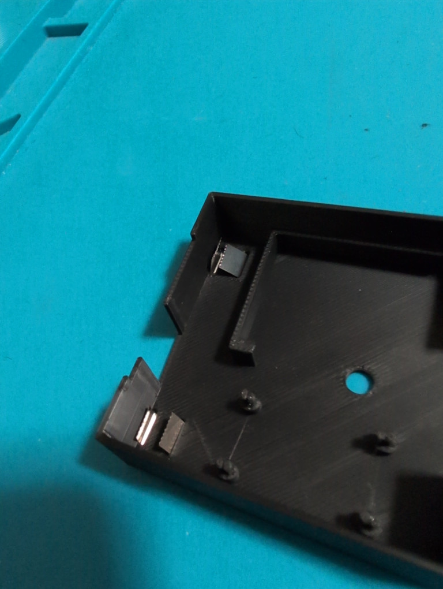

Cut the jumper on the back of the solar charger board to limit the charging current to 500mA.  

> [!CAUTION]
> Failure to cut the jumper may result overcharging the LiPo battery and burning your fucking house down! don't forget to cut the jumper!!!

Solder power wires with inline connector to the VIN and GND pins of the solar charger board.  

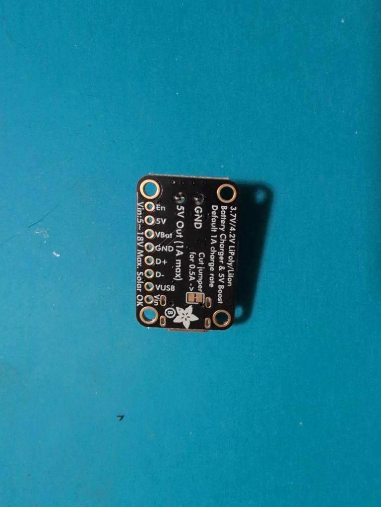

Mount the solar charger board in the battery pack and melt the pretension pins with a soldering iron.  

> [!NOTE]
> Use a low temperature on your soldering iron to melt the plastic. If you see smoke then your iron it too hot.

Connect the output terminals of the solar charger board to the battery pack contacts.  

> [!NOTE]
> Solder to the contacts in short bursts to avoid melting the 3D print too much.

Connect the 500mAh LiPo battery.

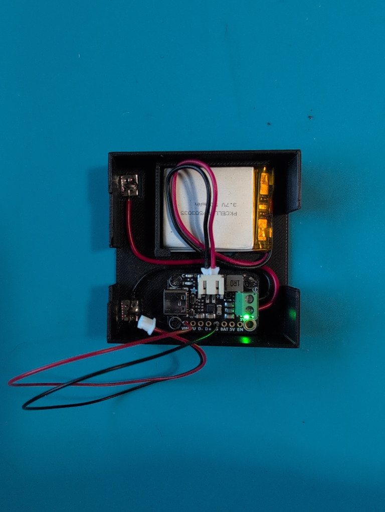

### Solar Panel

Remove the metal shield from the keypad.  

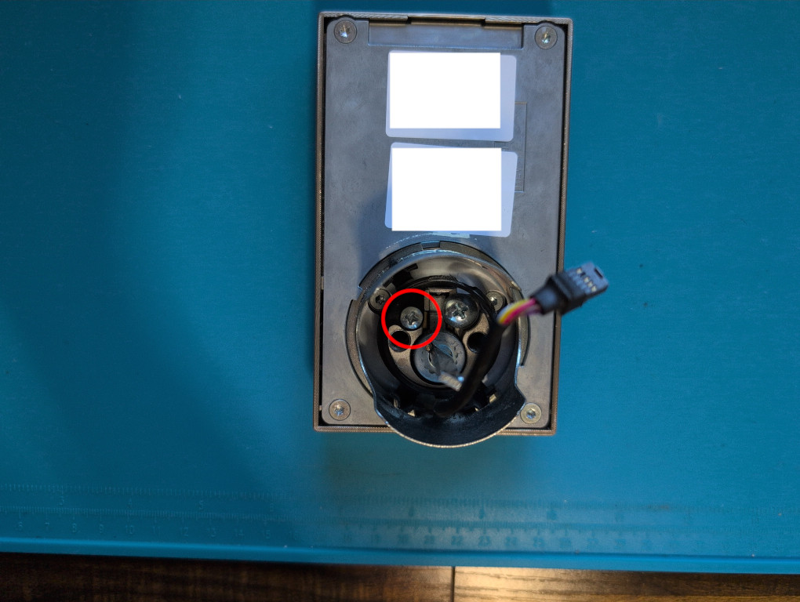

Remove the inner plastic piece from the metal shield reinstall it rotated 180 degrees.  

> [!NOTE]
> Take care to avoid breaking the plastic piece like I did.

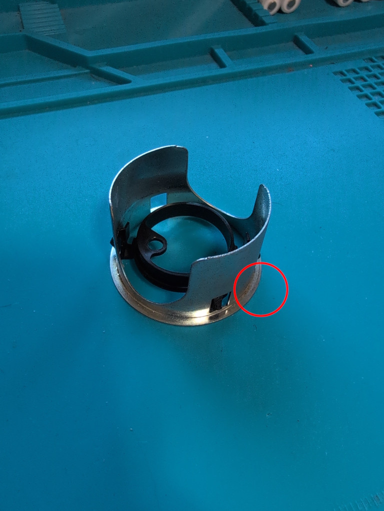
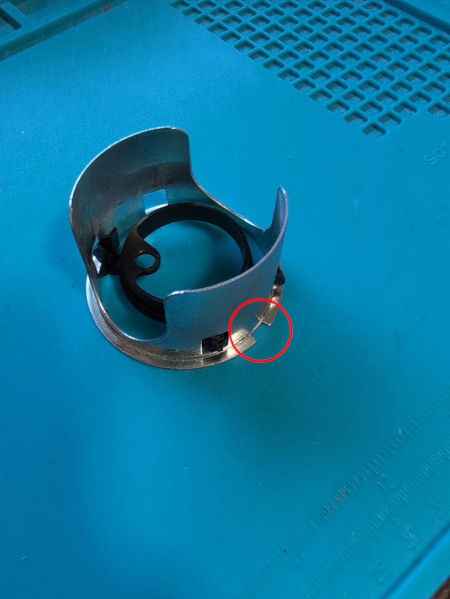

Reinstall the metal shield rotated 180 degrees, such that the notch lines up the the keypad's drain hole.  

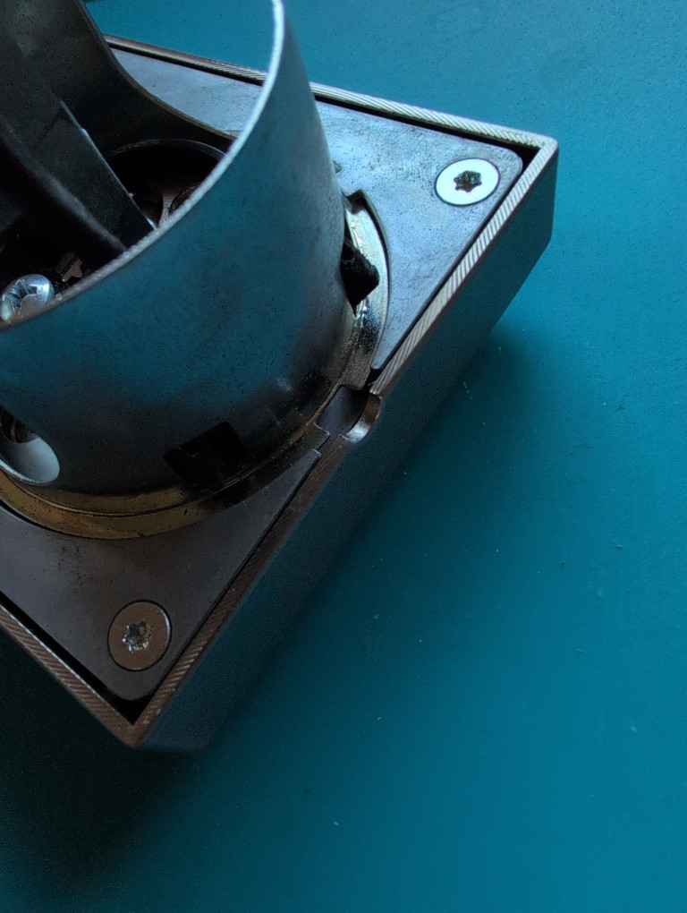

Feed solar panel wires though the hole.  

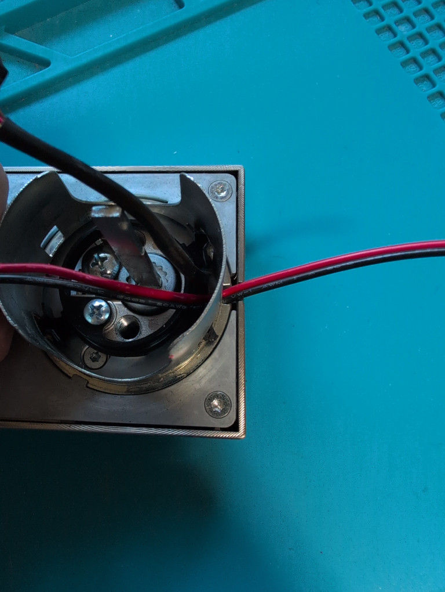

Solder on power wires with inline connector.  
Protect solder joints with heat shrink tubing.  

### Final Assembly

Route the solar panel wire into the battery compartment while reassembling the lock as you normally would.  

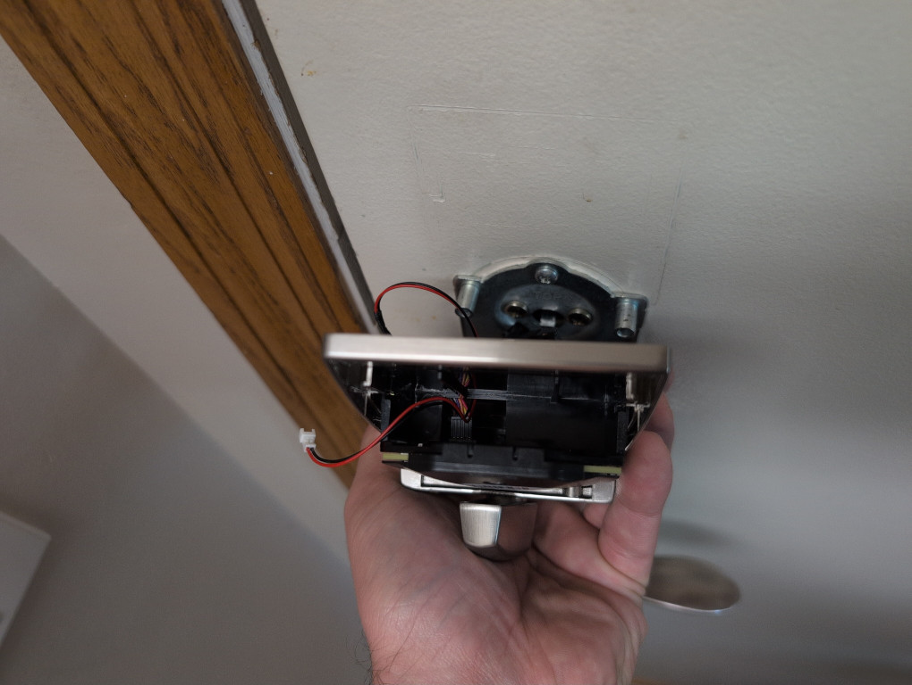

Loosen this screw until it no longer extends into the battery compartment.  

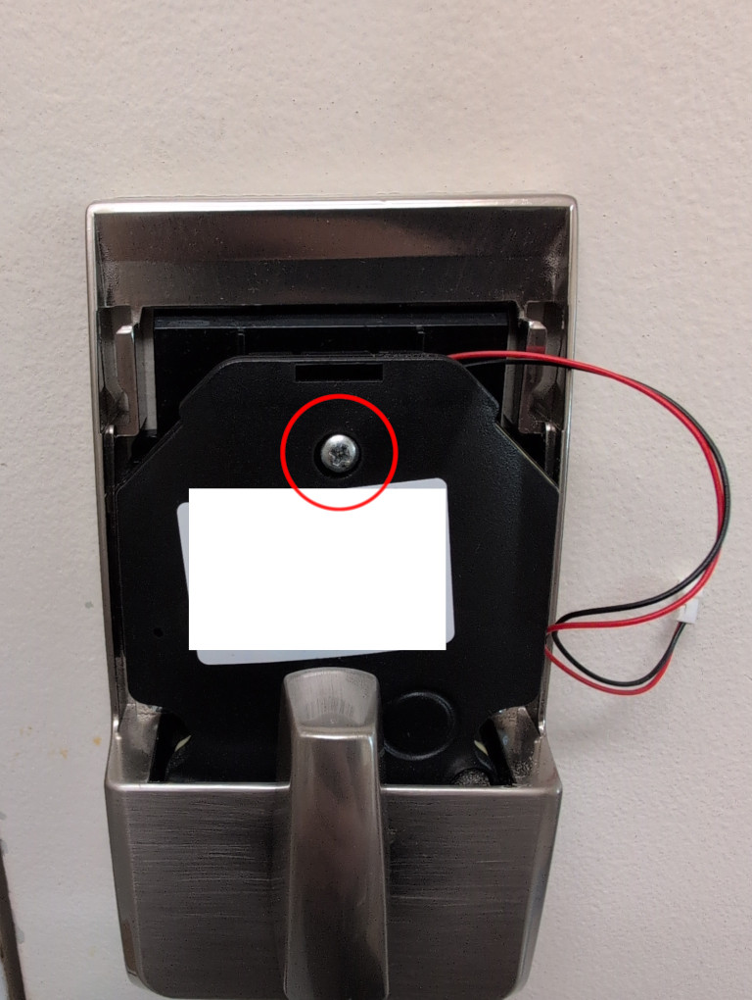

Connect the battery pack to the solar panel.  
Coil up excess wire inside the battery pack.  

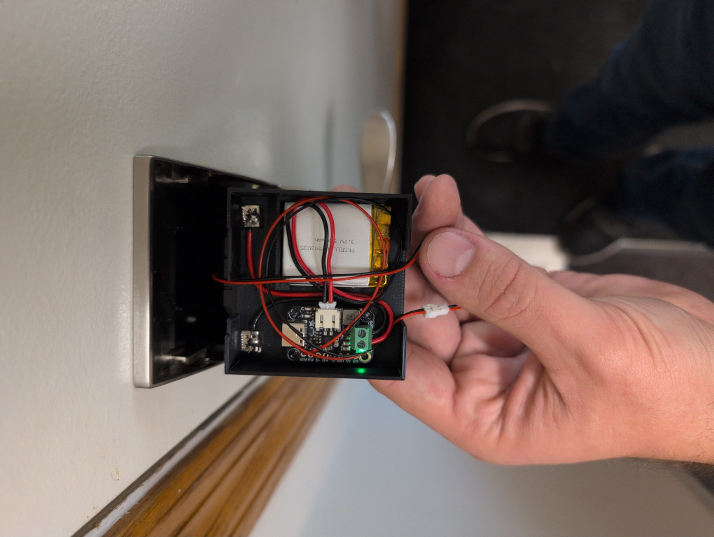

Insert the battery pack.

> [!NOTE]
> Holding lite upward pressure on the wires will make insertion easier.

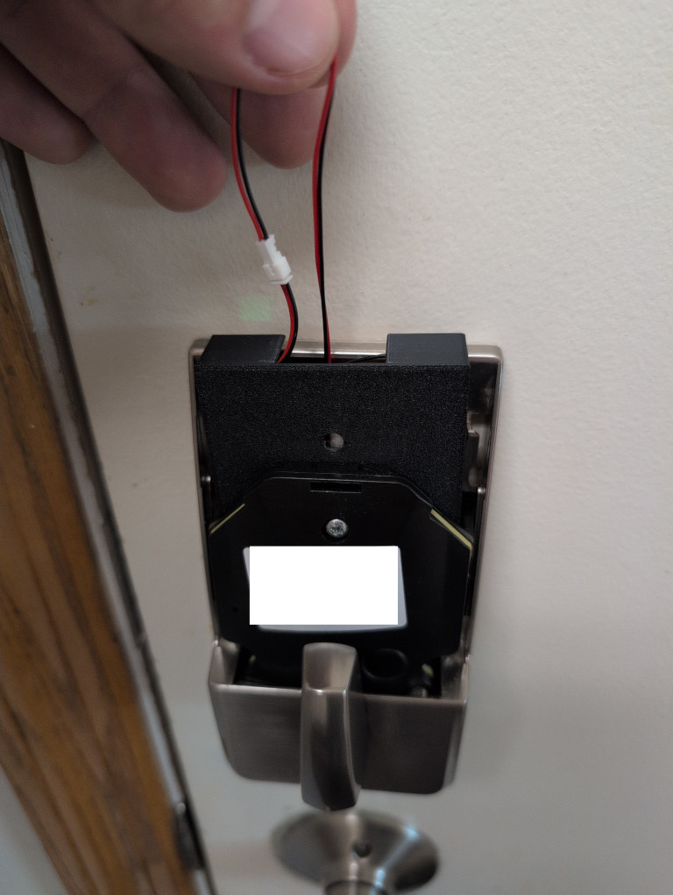

Gently push excess wire into the battery pack.  

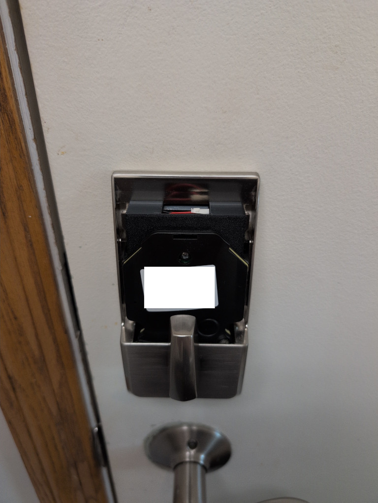

Tighten this screw again to lock the battery pack in place.  

Mount the solar panel to the door with outdoor rated hook and loop tape.  
